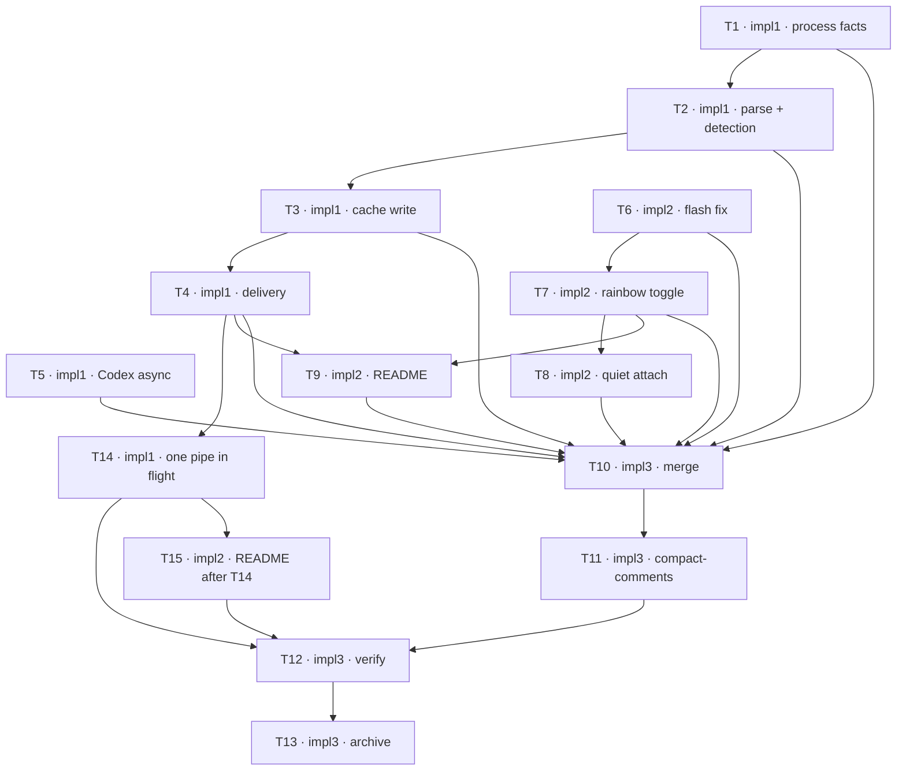

## TODOs: Spend less of the pod's CPU quota

Status legend: `[ ]` pending · `[x]` done. Each row's work is committed before its flip, and the flip follows in its own commit — both by the row's owner where its role is ungated, by that owner's critic on APPROVE where the `Critics:` line arms it.
Critics: plan=1 impl=1

**Gates run in a private tree.** Every test or build a row's gate runs — cargo or shell — runs in a private worktree, never in the shared tree:
- Before every gate, re-sync it to the current `HEAD` (`git worktree add --detach` once, since the branch is checked out in the shared tree), then apply only that agent's own changes: `git diff HEAD -- <the files its rows name>` piped through `git apply`, new files copied in. Never a bare `git diff`, which carries the other agent's half-edits, and never `git stash`, whose stack every worktree and session shares.
- Only the build cache is kept across rows (for example `/tmp/optimize-hook/gate-<agent>`).
- Why: `src/installer.rs` embeds `scripts/zellaude-hook.sh` through `include_str!`, and `src/manifest.rs` tests lift `state_cache_key()` out of it, so impl1's and impl2's gates would otherwise compile and run each other's unfinished edits, or pass on a base nobody commits.

### Hook
| ID | Agent | Task | Depends on | Status |
|----|-------|------|------------|--------|
| T1 | impl1 | Process facts in `scripts/zellaude-hook.sh`: `find_agent_pid` reads the memo (the pane's state record) for root events whose session id and host match, confirmed on Linux by a fork-free `/proc/<pid>/comm` read; `SessionStart` and `--inspect` never read it. On a miss: Linux climbs `/proc` with shell builtins under `ZELLAUDE_TREE_PROC_ROOT`; macOS runs one batched `ps` + `awk` that basenames `comm`, falling back to the per-process climb on empty output or nonzero exit. `claude_process_requested_mode` reads `/proc` the same way; `$EUID` replaces `id -u`. Tests in `tests/hook_mode_detection.sh`: exec counts per event, the batched-`ps` stub branch emitting full-path `comm` plus its fallback, tree-seam fixtures, `--inspect` output unchanged. | — | [x] |
| T2 | impl1 | Parse and detection in the hook: one `jq` pass reads every input field and stamps `ts_ms` (ms precision kept); Claude's transcript scan runs on `SessionStart` and `UserPromptSubmit` only, plus `SessionRestore` (attach recovery's `--inspect` event); one read of `zellaude.json` serves the launch-env names, `rainbow` (absent = true) and the notification mode; rainbow off skips detection and sends `rainbow_name: null`. Tests: exec counts, the scan rule per event, rainbow off. | T1 | [x] |
| T3 | impl1 | Cache write subset in `ensure_private_cache_dir` / `persist_root_state`: one `stat` per path for owner and mode, no `chmod` when already 700, one `jq` that reads the cached `ts_ms` and merges. `state_cache_key()` stays self-contained and `set -eu` clean; the hook keeps its trailing newline. Tests: exec counts; the manifest export still lifts `state_cache_key()`. | T2 | [x] |
| T4 | impl1 | Delivery: the hook never waits on any pipe. `deliver_payload` hands urgent events (`SessionStart`, `SessionEnd`, `UserPromptSubmit`, `PermissionRequest`, `Stop`) to a detached client at once, with the same reaper (5 s since rev 2, see T14), and coalesces the rest per (pane, root or subagent) stream — last writer within `DELIVERY_COALESCE_SECONDS=0.2` delivers, checked on wake against the stream's marker; Notification never supersedes and is dropped while its stream has one pending. A detached deliverer (own process group, stdio closed, 1 s reaper (5 s since rev 2, see T14), no orphaned `sleep`) skips a coalesced event when `session_is_clientless` reads `connected_clients 0`, failing open on missing or unparseable metadata. `zellij action pipe` replaces `zellij pipe`. `ZELLAUDE_DELIVERY_COALESCE_SECONDS` overrides the window. Tests, with the harness's fake `zellij` awaited: last event per stream lands, superseded never, urgent at once, the Notification rule, presence skip and fail-open, no orphans. | T3 | [x] |
| T14 | impl1 | One pipe in flight per session (rev 2, from T12's E2E failure): a fork-free per-session delivery lock beside T4's stream markers; a deliverer re-checks it is still its stream's newest after taking the lock; urgent events skip the window and take the lock ahead of coalesced waiters (a coalesced waiter yields while any urgent event of the session waits); a newer event of its own stream may supersede a waiting urgent event, except `SessionEnd`, which always pipes. Bounds: the running pipe is reaped at `DELIVERY_REAPER_SECONDS=5`; a lock older than the reaper plus 2 s is stale, judged by age, never pid; a waiter gives up after 3 × the reaper, dropping a coalesced event and piping an urgent one without the lock; no orphans. Tests: one pipe at a time under a burst; piled-up events collapse to each stream's latest; an urgent event jumps coalesced waiters; a superseded non-`SessionEnd` urgent event never pipes while `SessionEnd` always does; a stale lock is broken by age; the give-up path for both classes; the reaper bound. | T4 | [x] |
| T5 | impl1 | Codex hook entry gains `"async": true` (timeout stays 3) in `scripts/install-hooks.sh` and `src/installer.rs`; `tests/install_*.sh` follow the new entry shape. | — | [x] |

### Plugin
| ID | Agent | Task | Depends on | Status |
|----|-------|------|------------|--------|
| T6 | impl2 | Persist-flash leak fix: the `SessionEnd` branch of `handle_hook_event` drops the pane's flash deadline; `prune_orphan_flashes` in the Timer arm drops deadlines whose pane has no session. Tests in `tests/event_handler.rs`: a Persist deadline is gone after `SessionEnd`, and the timer returns to 1 Hz. | — | [x] |
| T7 | impl2 | Rainbow toggle: `Settings.rainbow` (serde default true) and `SettingKey::Rainbow` in `src/state.rs`; a settings-menu row in `src/render.rs`; the render gate draws a name as non-rainbow when off (no rainbow colors, no rainbow-driven bold; active and flash bold stay); `should_animate_rainbow` gates the 0.25 s ticker at the Timer call site while `has_rainbow_sessions` stays truthful. Update the `Settings` mirrors in `tests/event_handler.rs` and `tests/render_theme.rs`; tests for the gates and the absent-key default. | T6 | [x] |
| T8 | impl2 | Quiet attach in `src/main.rs`: a `zellaude:request` is answered only when `holds_shareable_sessions`. The active tab's instance runs the session-wide attach work — installer, attach scan, session-template compile — and broadcasts `ATTACH_DONE_PIPE` only when all three succeed; receivers mark all three done for their lifetime; with no broadcast, hidden instances keep today's first-visit fallback. Config load stays per instance. Tests: the sync gate; attach-done only on success; receivers skip; fallback without it. | T7 | [x] |
| T9 | impl2 | `README.md`: the delivery description (`zellij pipe` → `zellij action pipe`, near :577 and :581) and a Rainbow row in the Settings table (near :337). | T4, T7 | [x] |
| T15 | impl2 | README delivery sentences after T14 (rev 3): `README.md:578` (from T9, 56e4333) says urgent events "go out at once", which T14 makes false. Replace those two sentences with: "Each session runs one pipe at a time, so a backlog delivers only each agent's newest state, though a session end always goes out. Session start, prompt, permission, stop and session end events go ahead of the rest; tool, subagent and notification events first wait 0.2 s, and skip sessions with no client attached." Adjust only if T14 as built differs. | T14 | [x] |

### Finalize
| ID | Agent | Task | Depends on | Status |
|----|-------|------|------------|--------|
| T10 | impl3 | Merge from the integration branch: the moment deps clear — no gate — merge `develop` into the feature branch, resolving conflicts with best judgment. An extra merge loop appends fresh rows — this one never re-runs. Protocol: `madev:impl` Finalization. | T1, T2, T3, T4, T5, T6, T7, T8, T9 | [x] |
| T11 | impl3 | Compact-comments pass over the touched files per the session's coding standards: default none, one line each, no history or rationale; light touch-ups, no behavior change; remove resolved CLAUDE notes; commit. | T10 | [x] |
| T12 | impl3 | Run the PLAN's Verification on the merged + tidied state — tests and builds, load-independent cost, the E2E, the `dump-layout` arm, the throttling arm and the `action pipe` floor check — preflight first, then run unattended when it fits; artifacts to `/tmp/optimize-hook`. On failure or preflight no-go, report to the planner and wait for the routed fix — never self-fix, never free up resources; loop until clean. | T11, T14, T15 | [ ] |
| T13 | impl3 | Archive on the planner's explicit go: clear leftover feature CLAUDE notes, append the History entry, delete/prune this feature's in-flight seeds, `git rm` the PLAN, TODO and review guide (`[archive]`), `macoord cleanup`. Protocol: `madev:impl` Finalization. | T12 | (Not possible to mark after deletion) |

**Dependency graph**

**Launch order** — open every session at once; blocked ones idle on `wait-for`.
- `impl1` — entry T1 (—) · `impl1-crit1`
- `impl2` — entry T6 (—) · `impl2-crit1`
- `impl3` — entry T10 (waits on T1–T9) · `impl3-crit1`
